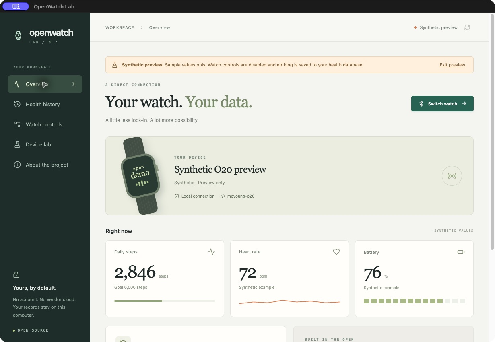
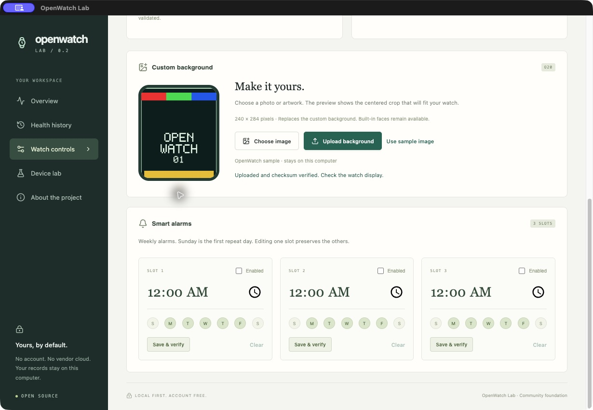

# OpenWatch Lab — itel Fit O20 / ISW-O20 companion

**An open-source, account-free iPulse alternative for the itel Fit O20 smartwatch.** Connect directly over Bluetooth, keep your records locally, change settings and upload custom watch backgrounds without a vendor account.

[](https://github.com/juangrukat/openwatch-lab/actions/workflows/check.yml) [](LICENSE)

[Download the Mac app](https://github.com/juangrukat/openwatch-lab/releases/latest) · [Protocol documentation](docs/PROTOCOL.md) · [Add a watch adapter](docs/ADAPTERS.md) · [Contribute](CONTRIBUTING.md)



*Overview shown in synthetic preview mode. These sample health values are fabricated; no personal health records are published.*

## Supported watch and platforms

The first adapter targets **itel Fit O20**, advertised as **itel ISW-O20**, manufacturer **MOYOUNG-V2**, software **O20-7LH2-2.1.12**. Other watches are not automatically compatible because they use iPulse, Da Fit or a similar Bluetooth service.

| Platform | Status |
|---|---|
| macOS, Apple Silicon | Packaged app and real O20 connection tested |
| Windows | Source/build configuration and CI supplied; BLE hardware and installer unverified |
| Android / iPhone | Future work; no mobile app in this release |
| Other watch models | Adapter contributions welcome; unknown devices are inspection-only |

Writes are disabled on software versions outside the validated O20 profile. Account-free operations worked after a watch reset on the same Mac; a completely fresh host with no prior Bluetooth state has not been tested.

## What works in version 0.2.0

- Scan, explicitly select, connect and disconnect your watch without iPulse login.
- Read battery, device versions, current steps and live heart rate.
- Change step goal, English language, time-format/units values, raise-to-wake and movement-reminder switch, with read-back verification.
- Create, edit and clear three weekly alarm slots while preserving the other slots.
- Start and stop heart-rate and oxygen measurements.
- Retrieve saved oxygen, stress and workout records, with source timestamps and local JSON export.
- Send a local test notification and an audible find-watch signal.
- Select tested built-in watch faces and upload **custom photo backgrounds**.
- Inspect capabilities, GATT services and a bounded local packet log.

Some raw setting labels and distance/calorie units remain provisional. A matching settings read-back establishes storage, not every physical effect. **Fresh numeric oxygen results are not verified**; saved records are never relabeled as a new measurement. Sleep, complete workout HR pagination, contacts UI, music files, calling audio, weather and firmware replacement are not implemented. See [feature investigation](docs/FEATURE-INVESTIGATION.md) and [validation](docs/VALIDATION.md).

## Custom watch backgrounds

In **Watch controls → Custom background**, choose a PNG, JPEG or WebP image, inspect the centered crop, then select **Upload background**. The app creates the O20's 240 × 284 image and 140 × 163 preview locally. Progress, cancellation, negotiated transfer sizes and whole-file checksum verification are included. A built-in sample lets you test without choosing a personal photo.



*A generated test pattern is shown; no personal photo is included. Upload replaces the custom background. It does not install firmware or additional watch apps.*

The [validated custom-background protocol](docs/O20-CUSTOM-BACKGROUNDS.md) and [synthetic fixture](fixtures/synthetic/o20-background.json) are documented so others can build independent implementations. The observed 500 KiB object-transfer ceiling is **not** the watch's total RAM, total flash or free storage.

## Download and connect

1. Download the **macOS Apple Silicon** ZIP from [Releases](https://github.com/juangrukat/openwatch-lab/releases/latest), extract it and open **OpenWatch Lab.app**. The early Mac build is unsigned and not notarized; source builds are also available below.
2. Enable Bluetooth. Keep iPulse and other watch companions closed during connection.
3. Choose **Connect a watch**, allow the OS Bluetooth permission if requested, then select **itel ISW-O20**.
4. Open **Watch controls** for alarms/settings/backgrounds or **Health history** to sync stored records.

BLE watches need not appear in macOS Bluetooth Settings. This app discovers the device through Bluetooth Low Energy GATT. It does not automatically connect to every device found in a scan.

**Synthetic preview** is opt-in, clearly labeled and read-only. It writes neither watch settings nor fabricated records into your real database.

## Run from source

Requirements: Node.js **22.12+**, Python **3.11+**, and a working Bluetooth Low Energy adapter.

```sh
git clone https://github.com/juangrukat/openwatch-lab.git
cd openwatch-lab
python3 -m venv .venv
.venv/bin/python -m pip install -e '.[dev]'
npm ci
npm run dev
```

On Windows, use `python -m venv .venv` and `.venv\Scripts\python -m pip install -e ".[dev]"`, then the same npm commands. Windows remains a build target pending hardware validation.

## Privacy and local storage

No account, telemetry, vendor SDK or cloud service is required by the implemented operations. Electron talks to a Python/Bleak sidecar over inherited standard input/output; there is no local HTTP listener. SQLite stores observations and device associations in your OS application-data directory. The exact path appears under **About the project**. Export writes JSON only to a location you choose.

Images stay local and are staged transiently for upload. Packet inspection is limited to 200 in-memory entries and is excluded from observation exports. Personal research captures, stable device identifiers, databases and vendor binaries are not distributed in this repository.

## Build and verify

```sh
.venv/bin/python -m pytest --cov=openwatch
.venv/bin/python -m mypy
.venv/bin/python -m ruff check packages/watch-core/openwatch
npm run check
npm run backend:bundle
npm run package:mac
```

For Windows, run `npm run backend:bundle` and `npm run package:win` **on Windows**. Each OS needs a native backend build. Local validation: **26 Python tests + 4 Node tests**, 96% backend statement coverage, strict typing/lint and production UI build. CI results are visible in [Actions](https://github.com/juangrukat/openwatch-lab/actions); they do not establish Bluetooth hardware support.

## An open foundation for other watches

The interface, Bluetooth transport, pure protocol codecs, storage and device adapters are separate. Start with the [adapter template](adapter-template/README.md), [read-only example](adapter-template/adapter.py) and [contribution guide](CONTRIBUTING.md). Use fabricated fixtures and record which features were physically confirmed on each model and firmware.

The common API is a versioned interoperability proposal, not a certified universal smartwatch standard. Unknown models do not receive vendor writes automatically. This project is independent of itel, iPulse and Moyoung.

## License and acknowledgments

Application and adapter code: **AGPL-3.0-or-later** ([LICENSE](LICENSE)). Original protocol/interface documentation and synthetic fixtures: **CC0-1.0** ([dedication](docs/CC0-1.0.txt)). Dependencies retain their own licenses. See [NOTICE.md](NOTICE.md) for Gadgetbridge reference attribution and runtime notices.
